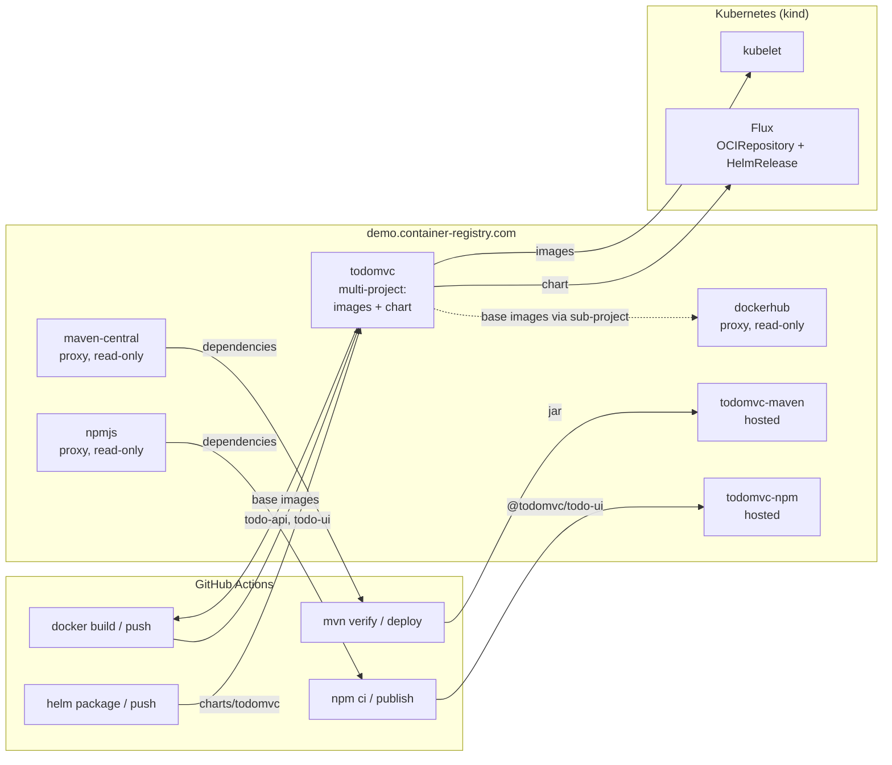
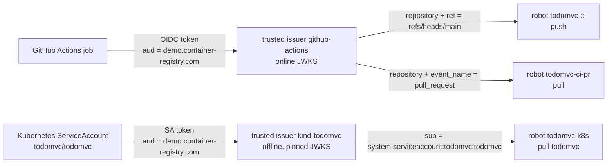

# One registry, keyless, from source to cluster

The complete, runnable example of [8gcr](https://container-registry.com/8gcr)
(Harbor Next 2.16) as the only artifact store of a project, run against
`https://demo.container-registry.com`. A Java/Maven backend and
an npm frontend are built in GitHub Actions, packaged as container images and a
Helm chart, and deployed by Flux to a Kubernetes cluster. Every dependency comes
through Harbor, every artifact goes into Harbor, and no registry secret is
stored anywhere.

The TodoMVC apps in `apps/` only exist to give the flow something real to build.

## The flow



## The project layout

| Project | Kind | Clients use it for |
|---|---|---|
| `maven-central` | proxy cache of Maven Central, read-only, public | Maven mirror (`mirrorOf *,!8gcr-hosted`) |
| `todomvc-maven` | hosted, public | Maven `distributionManagement` and the `8gcr-hosted` repository |
| `npmjs` | proxy cache of npmjs.org, read-only, public | `.npmrc` `registry=` |
| `todomvc-npm` | hosted, public | `.npmrc` `@todomvc:registry=` |
| `todomvc` | multi-project, private | push and pull of images and the Helm chart; base images through it |
| `dockerhub` | proxy cache of Docker Hub, read-only, private | only as sub-project of `todomvc` |

Multi-project resolution in 2.16 works for OCI artifacts only, so npm and Maven
use a proxy and a hosted project each. [01: Concepts](docs/01-concepts.md#the-layout-and-why)
has the reasons and the evidence.

## The keyless trust chain



Every client sends the token as the HTTP Basic password with user `jwt`.
Harbor checks signature, issuer and audience, then maps the claims to a robot
that has no secret of its own. Flux's source-controller and the kubelet (through
a KEP-4412 credential provider) both mint the ServiceAccount token themselves.

## Read it in order

The sections follow the flow. Paths and headings are stable for linking.

| Step | Page |
|---|---|
| Concepts | [docs/01-concepts.md](docs/01-concepts.md): layout, multi-project, trust chain |
| 1. Setup | [docs/02-setup.md](docs/02-setup.md): `scripts/setup-8gcr.py`, the API calls behind it |
| 2. Maven | [docs/03-maven.md](docs/03-maven.md): resolve through the proxy, deploy to hosted, resolve it back |
| 3. npm | [docs/04-npm.md](docs/04-npm.md): the same for npm, with a scoped package |
| 4. Images | [docs/05-images.md](docs/05-images.md): base images through the multi-project, push the app images |
| 5. Helm chart | [docs/06-helm-chart.md](docs/06-helm-chart.md): package and push the chart as OCI |
| 6. Pipeline | [docs/07-pipeline.md](docs/07-pipeline.md): the GitHub Actions workflows, tokens, robots, timings |
| 7. Flux deploy | [docs/08-flux-deploy.md](docs/08-flux-deploy.md): kind, offline trusted issuer, Flux and kubelet without secrets |

## Short path

```bash
export HARBOR_URL=https://demo.container-registry.com HARBOR_PASS=...
export GITHUB_REPO=<owner>/<repo>  # your fork; the CI robots trust only this repository
./scripts/setup-8gcr.py            # projects, trusted issuer, robots
# push to main, or: gh workflow run publish.yml --ref main
# build the credential provider first, see docs/08-flux-deploy.md
kind create cluster --config deploy/kind/kind-config.yaml
kubectl apply -f deploy/kind/node-audience-rbac.yaml
./scripts/setup-8gcr.py kind       # trust this cluster
kubectl apply -f https://github.com/fluxcd/flux2/releases/download/v2.10.0/install.yaml
kubectl apply -f deploy/flux/
```

`demo.container-registry.com` is a shared public demo; you can log in and look
around. To run the flow yourself, point it at your own 8gcr instance.

## Repository layout

```
apps/todo-api/        Spring Boot backend: the Maven artifact and one image
apps/todo-ui/         Vue 3 frontend: the npm package @todomvc/todo-ui and one image
deploy/chart/todomvc/ Helm chart for both, pushed as OCI
deploy/flux/          Namespace, ServiceAccount, OCIRepository, HelmRelease
deploy/kind/          kind config and the kubelet credential provider
.github/              The pipeline and the OIDC token action
scripts/setup-8gcr.py The only provisioning step, idempotent
docs/                 The walkthrough
```

To point this at your own instance, change `demo.container-registry.com` in
`apps/todo-api/pom.xml`, `apps/todo-api/.mvn/settings.xml`, `apps/todo-ui/.npmrc`,
`.github/workflows/_pipeline.yml`, `deploy/chart/todomvc/values.yaml`,
`deploy/flux/` and `deploy/kind/`. On 8gcr builds newer than v2.16.0 the package
paths move from `/npm/` and `/maven/` to `/pkg/npm/` and `/pkg/maven/`; the same
files carry them.

Every command in the docs was run against the demo (v2.16.0) on 2026-11-20 and
the output shown is what it printed, trimmed.
