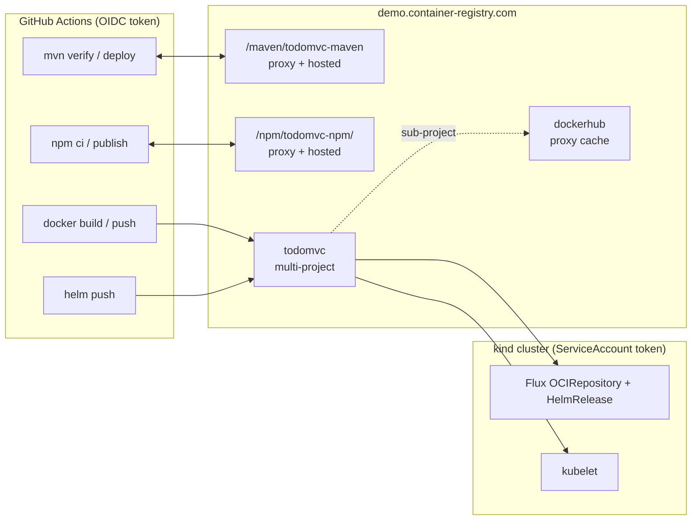

# One registry, keyless, from source to cluster

A working end-to-end example of [8gcr](https://container-registry.com/8gcr)
(Harbor Next 2.16) as the only artifact store of a project, run against the
public demo at `https://demo.container-registry.com`:

1. A Java/Maven backend and an npm frontend build in GitHub Actions. Every
   dependency resolves through Harbor proxy caches of Maven Central and
   npmjs.org, and the jar and the npm package are published back into them.
2. Both apps are built into container images, with base images pulled
   through Harbor's Docker Hub proxy cache, and pushed to Harbor.
3. A Helm chart for the app is pushed to Harbor as an OCI artifact.
4. CI authenticates with its GitHub OIDC token as the password. There is no
   registry secret anywhere.
5. Flux on a kind cluster installs the chart and the kubelet pulls the
   images, both with the cluster's own ServiceAccount tokens. Still no secret.

The TodoMVC apps in `apps/` only exist to give the flow something real to build.



## Read it in order

| | |
|---|---|
| [01: Concepts and project layout](docs/01-concepts.md) | Proxy cache, multi-project, the four projects and why |
| [02: Registry setup](docs/02-registry-setup.md) | `scripts/setup-8gcr.py`, the API calls behind it, trusted issuer and robots |
| [03: Maven and npm](docs/03-maven-and-npm.md) | Resolve through the proxy, publish, read back |
| [04: CI, images and chart, keyless](docs/04-ci-keyless.md) | The GitHub Actions pipeline, base images through the multi-project, Helm as OCI |
| [05: Flux on kind, keyless](docs/05-flux-on-kind.md) | Offline trusted issuer, Flux ServiceAccount-token auth, kubelet credential provider |

## Short path

```bash
export HARBOR_URL=https://demo.container-registry.com HARBOR_PASS=...
export GITHUB_REPO=<owner>/<repo>  # your fork; the CI robots trust only this repository
./scripts/setup-8gcr.py            # registry side and CI identity
# push to main, or: gh workflow run publish.yml --ref main
kind create cluster --config deploy/kind/kind-config.yaml   # after building the provider, see 05
./scripts/setup-8gcr.py kind       # trust this cluster
kubectl apply -f https://github.com/fluxcd/flux2/releases/download/v2.10.0/install.yaml
kubectl apply -f deploy/flux/
```

**The demo is wiped every Sunday at 03:17 UTC. Rerun `./scripts/setup-8gcr.py`
(and `kind` for a running cluster) after a reset**, then run the publish
workflow once so there is a chart to deploy. Every account on the demo is an
admin, so anyone can change these projects; the setup script tells you when
something no longer matches.

## Repository layout

```
apps/todo-api/        Spring Boot backend: the Maven artifact and one image
apps/todo-ui/         Vue 3 frontend: the npm artifact and one image
deploy/chart/todomvc/ Helm chart for both, pushed as OCI
deploy/flux/          Namespace, ServiceAccount, OCIRepository, HelmRelease
deploy/kind/          kind config and the kubelet credential provider
.github/              The pipeline and the OIDC token action
scripts/setup-8gcr.py The only provisioning step, idempotent
docs/                 The walkthrough
```

Pointing this at your own instance means changing `demo.container-registry.com`
in `apps/todo-api/pom.xml`, `apps/todo-api/.mvn/settings.xml`,
`apps/todo-ui/.npmrc`, `.github/workflows/_pipeline.yml`,
`deploy/chart/todomvc/values.yaml`, `deploy/flux/` and `deploy/kind/`.

Every command in the docs was run against the demo on 2026-11-20 and the
output shown is what it printed, trimmed.
