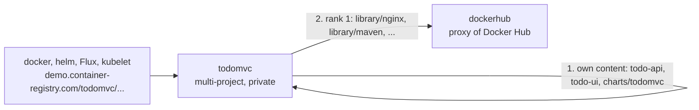

# Concepts: layout, multi-project, trust chain

[README](../README.md) · [Setup →](02-setup.md)

## Three kinds of project

**Proxy cache.** A project bound at creation to a *registry endpoint* (an
upstream such as npmjs.org). It serves what it holds and fetches a miss from
upstream, storing it for the next request. Here every proxy cache is read-only.

**Hosted.** A plain project. It holds what you push and nothing else. On 2.16
a plain project serves npm and Maven as well as OCI; no package-type setting is
needed.

**Multi-project** (new in 2.16, beta). A project created with
`metadata.multi_project=true` that references other projects as ranked
*sub-projects*. A pull from it resolves in this order:

1. the multi-project's own content,
2. each sub-project by rank, and for a proxy-cache sub-project also its upstream.

Pushes always land in the multi-project itself. Authorization is checked
against the multi-project only, so a client that may pull from it reads
sub-project content without any grant on the sub-project.

## The layout, and why

| Project | Kind | Holds |
|---|---|---|
| `maven-central` | proxy, read-only, public | Maven Central |
| `todomvc-maven` | hosted, public | the `todo-api` jar |
| `npmjs` | proxy, read-only, public | npmjs.org |
| `todomvc-npm` | hosted, public | the `@todomvc/todo-ui` package |
| `todomvc` | multi-project, private | `todo-api` and `todo-ui` images, `charts/todomvc`; Docker Hub through its sub-project |
| `dockerhub` | proxy, read-only, private | Docker Hub |



### OCI: one multi-project

CI pushes `todo-api`, `todo-ui` and `charts/todomvc` to `todomvc`, and the
Dockerfiles take their base images from `todomvc/library/...`, which the
multi-project serves from its `dockerhub` sub-project. Clients have one URL
for the app and everything it is built on, and Flux and the kubelet need one
pull grant.

The app images and the chart are pushed into the multi-project itself rather
than into a hosted sub-project. Pushes to a multi-project stay there and are
always served first, so a hosted sub-project would only add a second URL. It
would also break version ranges: `tags/list` on a multi-project lists only its
own tags, not those of its sub-projects. Measured with a pull token for
`todomvc`:

```console
$ curl -H "Authorization: Bearer $T" https://demo.container-registry.com/v2/todomvc/charts/todomvc/tags/list
{"name":"todomvc/charts/todomvc","tags":["0.1.12","0.1.13"]}
$ curl -H "Authorization: Bearer $T" https://demo.container-registry.com/v2/todomvc/library/nginx/tags/list
{"errors":[{"code":"NOT_FOUND","message":"repository todomvc/library/nginx not found"}]}
```

`todomvc/library/nginx:alpine` pulls fine through the same project. Only the
listing is missing. Flux's `semver` range on the chart works because the chart
is the multi-project's own content. Never point a range at an artifact that
only a sub-project holds.

### npm and Maven: a proxy and a hosted project per format

Two facts of 2.16 decide this.

**Multi-project resolution is OCI only.** It is wired into the `/v2/`
manifest and blob routes. The npm and Maven handlers resolve exactly one
project and never consult sub-projects. The API still accepts a package proxy
as a sub-project, so this is easy to get wrong:

```console
$ curl -s -u "admin:$PASS" -X POST "$API/projects" -H 'Content-Type: application/json' \
    -d '{"project_name":"probe-multi-npm","metadata":{"public":"true","multi_project":"true"}}' -w '%{http_code}\n'
201
$ curl -s -u "admin:$PASS" -X POST "$API/projects/probe-multi-npm/subprojects" -H 'Content-Type: application/json' \
    -d '{"sub_project_name":"npmjs","rank":1}' -w '%{http_code}\n'
201
$ curl -s -w ' %{http_code}\n' https://demo.container-registry.com/npm/probe-multi-npm/vue
{"error":"package not found"} 404
$ curl -s -o /dev/null -w '%{http_code}\n' https://demo.container-registry.com/npm/npmjs/vue
200
```

**Publishing into a proxy cache is being removed.** v2.16.0 still accepts
`proxy_cache_allow_push=true` and lets you publish into a proxy project:

```console
$ npm publish        # @probe/hello@1.0.1, @probe:registry=.../npm/todomvc-npm/ (then a proxy project)
npm notice Publishing to https://demo.container-registry.com/npm/todomvc-npm/ with tag latest and default access
+ @probe/hello@1.0.1
$ curl -s -u "admin:$PASS" -T hello-1.0.jar .../maven/todomvc-maven/com/probe/hello/1.0/hello-1.0.jar -w '%{http_code}\n'
201
```

8gcr change #658, merged after the v2.16.0 release, makes proxy-cache projects
read-only and drops the flag. A layout that relies on it breaks on the next
release, so this one does not use it.

The result is two URLs per format, each with one job, and both client tools
support exactly that split:

| | Resolve from | Publish to |
|---|---|---|
| Maven | mirror `*,!8gcr-hosted` → `maven-central` | `distributionManagement` id `8gcr-hosted` → `todomvc-maven` |
| npm | `registry=` → `npmjs` | `@todomvc:registry=` → `todomvc-npm` |

A consumer of the published artifact uses the same files: Maven lists
`8gcr-hosted` as a repository, npm routes the `@todomvc` scope to the hosted
project. [03](03-maven.md#resolve-it-back) and [04](04-npm.md#resolve-it-back)
show both.

### Public and private

The package projects are public because `docker build` resolves npm and Maven
dependencies inside the image build, where no credential is passed. `todomvc`
is private, so the Kubernetes side of the flow has to authenticate, and
[08](08-flux-deploy.md#proof-that-the-token-is-what-grants-access) shows that
it does.

## The trust chain

Nothing stores a registry password. Every client presents a short-lived token
as the HTTP Basic password, user `jwt`. Harbor validates it against a *trusted
issuer* (signature, `iss`, and `aud`, which must equal the registry host) and
maps its claims to a *secretless robot*:

| Who | Token | Trusted issuer | Claim rules | Robot | Can |
|---|---|---|---|---|---|
| GitHub Actions on `main` | GitHub OIDC, 300 s | `github-actions`, online JWKS | `repository`, `ref = refs/heads/main` | `todomvc-ci` | push and pull `todomvc`, `todomvc-npm`, `todomvc-maven` |
| GitHub Actions, pull requests | GitHub OIDC, 300 s | `github-actions` | `repository`, `event_name = pull_request` | `todomvc-ci-pr` | pull the same |
| Flux and kubelet | ServiceAccount token | `kind-todomvc`, offline, pinned JWKS | `sub = system:serviceaccount:todomvc:todomvc` | `todomvc-k8s` | pull `todomvc` |

A token that matches no robot is treated as anonymous.

| Client | How the token is passed |
|---|---|
| Maven | `<server>` id `8gcr-hosted`, `${env.HARBOR_USERNAME}` / `${env.HARBOR_PASSWORD}` |
| npm | `//host/npm/todomvc-npm/:_auth=<base64 of "jwt:<token>">`. `_authToken` (Bearer) is not accepted. |
| docker, helm | `login -u jwt --password-stdin` |
| Flux source-controller | ServiceAccount annotations, `credential.auth.fluxcd.io/username: jwt` |
| kubelet | KEP-4412 credential provider returning `jwt` and the pod's ServiceAccount token |

## Next

[Setup](02-setup.md)
