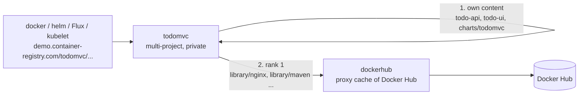

# 01: Concepts and project layout

[README](../README.md) · [02: Registry setup →](02-registry-setup.md)

One 8gcr instance holds everything this example builds and consumes:
Maven and npm dependencies, the jar and the npm package it publishes, the
container images, their base images and the Helm chart. Each format has
exactly one URL, which every client uses for both reading and writing.

| Format | URL | Project | Clients |
|---|---|---|---|
| Maven | `https://demo.container-registry.com/maven/todomvc-maven` | `todomvc-maven` | `mvn` via `settings.xml` |
| npm | `https://demo.container-registry.com/npm/todomvc-npm/` | `todomvc-npm` | `npm` via `.npmrc` |
| OCI: images, chart, base images | `demo.container-registry.com/todomvc/...` | `todomvc` | `docker`, `helm`, Flux, kubelet |

## Two kinds of project, and the multi-project

**Proxy cache.** A project bound to a *registry endpoint* (an upstream such as
npmjs.org) serves what it holds and fetches a miss from upstream, storing it
for the next request. Created with `proxy_cache_allow_push=true`, it also
accepts publishing, and your own package of a given name is served before the
upstream one. Both the binding and the flag are fixed at creation.

**Multi-project** (new in 2.16, beta). A project created with
`metadata.multi_project=true` that references other projects as ranked
*sub-projects*. A pull resolves in this order:

1. the multi-project's own content,
2. each sub-project by rank, and for a proxy-cache sub-project also its upstream.

Pushes always land in the multi-project itself. Authorization is checked
against the multi-project only, so a client that may pull from `todomvc` reads
sub-project content through it without any grant on the sub-project.



## The layout, and why

```
todomvc         multi-project, private   app images + Helm chart; sub-project: dockerhub (rank 1)
dockerhub       proxy cache, private     Docker Hub, reachable only through todomvc
todomvc-maven   proxy cache, public      Maven Central + the published jar
todomvc-npm     proxy cache, public      npmjs.org + the published package
```

**OCI: one multi-project.** The CI pushes `todo-api`, `todo-ui` and
`charts/todomvc` to `todomvc`, and the Dockerfiles take their base images from
`todomvc/library/...`, which the multi-project serves from its `dockerhub`
sub-project. One URL covers the app and everything it is built on, and one
pull grant (`todomvc`) is all Flux and the kubelet need. A separate hosted
sub-project for the app images would add a second push URL and nothing else,
because pushes to a multi-project stay in the multi-project and always win
over sub-project content.

**Maven and npm: one proxy-cache project each, not a multi-project.** In 2.16.0
multi-project resolution exists only on the OCI routes (`/v2/.../manifests`
and `/v2/.../blobs`). The npm and Maven handlers do not consult sub-projects.
The API still accepts a package proxy as a sub-project, so this is easy to get
wrong. Measured on the demo:

```console
$ curl -s -u "admin:$PASS" -X POST "$API/projects" -H 'Content-Type: application/json' \
    -d '{"project_name":"probe-multi-npm","metadata":{"public":"true","multi_project":"true"}}' -w '%{http_code}\n'
201
$ curl -s -u "admin:$PASS" -X POST "$API/projects/probe-multi-npm/subprojects" -H 'Content-Type: application/json' \
    -d '{"sub_project_name":"todomvc-npm","rank":1}' -w '%{http_code}\n'
201
$ curl -s -w ' %{http_code}\n' https://demo.container-registry.com/npm/probe-multi-npm/vue
{"error":"package not found"} 404
$ curl -s -o /dev/null -w '%{http_code}\n' https://demo.container-registry.com/npm/todomvc-npm/vue
200
```

A proxy-cache project with `proxy_cache_allow_push=true` already gives the
one-URL property for a package format: it hosts what you publish and proxies
the rest. That is what `todomvc-maven` and `todomvc-npm` are.

**Why the package projects are public.** `docker build` resolves the npm and
Maven dependencies inside the image build, where no credential is passed in.
Public projects let those builds stay credential-free. The `todomvc`
multi-project is private, so the Kubernetes side of the flow has to
authenticate, and the walkthrough shows that it does.

**Why images do not go into the package projects.** A project bound to a
package-format endpoint refuses OCI manifest pushes.

## One credential mechanism everywhere

Nothing stores a registry password. Every client presents a short-lived OIDC
token as the HTTP Basic password, with any username (`jwt` by convention).
Harbor validates the token against a *trusted issuer* and maps its claims to a
*secretless robot*:

| Who | Token | Trusted issuer | Robot | Can |
|---|---|---|---|---|
| GitHub Actions, push and manual runs | GitHub OIDC | `github-actions` (online JWKS) | `todomvc-ci` | push and pull all three projects |
| GitHub Actions, pull requests | GitHub OIDC | `github-actions` | `todomvc-ci-pr` | pull only |
| Flux and kubelet in the kind cluster | Kubernetes ServiceAccount token | `kind-todomvc` (offline, pinned JWKS) | `todomvc-k8s` | pull `todomvc` |

The token's `aud` must equal the trusted issuer's audience. Here that is the
registry host, `demo.container-registry.com`, so a token minted for any other
service is useless against this registry.

| Client | How the token is passed |
|---|---|
| npm | `_auth=<base64 of "jwt:<token>">` in `.npmrc`. `_authToken` (Bearer) is not accepted. |
| Maven | `<server>` with id `8gcr`, matching the mirror and `distributionManagement` |
| docker, helm | `login -u jwt --password-stdin` |
| Flux source-controller | ServiceAccount annotations, `credential.auth.fluxcd.io/username: jwt` |
| kubelet | KEP-4412 credential provider returning `jwt` + the pod's ServiceAccount token |

## Next

[02: Registry setup](02-registry-setup.md)
