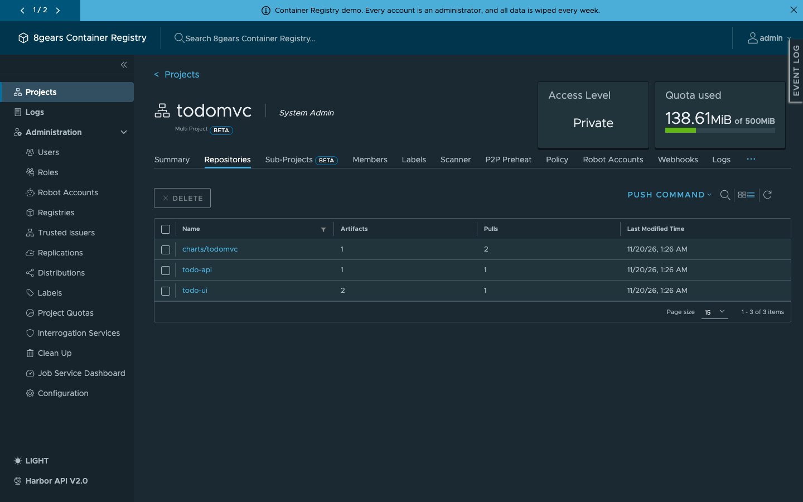
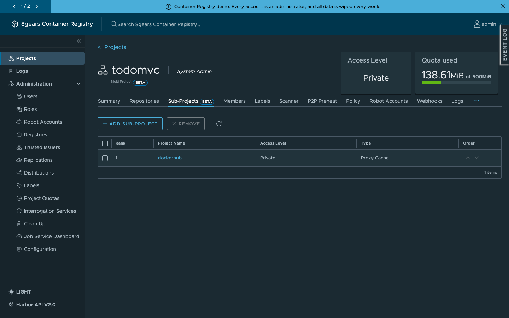

# 04: CI, images and chart, keyless

[← 03: Maven and npm](03-maven-and-npm.md) · [05: Flux on kind →](05-flux-on-kind.md)

One reusable workflow, [`_pipeline.yml`](../.github/workflows/_pipeline.yml),
runs from two entry points:

| Entry point | Trigger | `publish` | Token becomes |
|---|---|---|---|
| [`build.yml`](../.github/workflows/build.yml) | `pull_request` | false | `todomvc-ci-pr`, pull only |
| [`publish.yml`](../.github/workflows/publish.yml) | push to `main`, `workflow_dispatch` on any branch | true | `todomvc-ci`, push and pull |

Both grant `id-token: write`. The boundary between them is not in the workflow
files but in Harbor's claim rules ([02](02-registry-setup.md#what-it-does-as-api-calls)):
a token whose `event_name` is `pull_request` maps to the robot that cannot push,
whatever the pull request's build code does with it. Pull requests from forks
get no OIDC token from GitHub, so their runs fail at the auth step.

```
version ─┬─ maven   resolve via todomvc-maven, verify, publish jar
         ├─ npm     resolve via todomvc-npm, build, publish package
         ├─ images  (todo-api, todo-ui) base images via todomvc, build, push
         │    └─ chart   helm package, push to todomvc/charts
         └─ verify  pull images and chart, npm view, mvn dependency:get (publish only)
```

## The token

[`.github/actions/8gcr-token`](../.github/actions/8gcr-token/action.yml) asks
GitHub for an OIDC token with the registry host as audience, masks it, and
returns it as the password. There is no exchange step: Harbor validates the
token itself. The action logs the claims that matter:

```console
token for aud=demo.container-registry.com event_name=workflow_dispatch ref=refs/heads/feat/v216-e2e, valid 300s
```

**The token is valid for 300 seconds.** The first run of this pipeline minted
one token at the start of the Maven job and used it for `mvn deploy` seven
minutes later:

```console
[ERROR] Failed to execute goal org.apache.maven.plugins:maven-deploy-plugin:3.1.4:deploy (default-deploy) on project todo-api: Failed to deploy artifacts: Could not transfer artifact com.containerregistry.todo:todo-api:pom:0.1.12 from/to 8gcr (https://demo.container-registry.com/maven/todomvc-maven): status code: 401, reason phrase: Unauthorized (401)
```

So every job mints a second token right before it pushes.

Each client takes the token its own way:

```bash
printf '%s' "$TOKEN" | docker login demo.container-registry.com -u jwt --password-stdin
printf '%s' "$TOKEN" | helm registry login demo.container-registry.com -u jwt --password-stdin
echo "//demo.container-registry.com/npm/todomvc-npm/:_auth=$(printf 'jwt:%s' "$TOKEN" | base64 | tr -d '\n')" >> .npmrc
HARBOR_USERNAME=jwt HARBOR_PASSWORD="$TOKEN" mvn -s .mvn/settings.xml deploy
```

## Images, with base images through the multi-project

Both Dockerfiles take their base images from a build argument:

```dockerfile
ARG BASE_REGISTRY=docker.io/library
FROM ${BASE_REGISTRY}/maven:3.9-eclipse-temurin-21 AS build
...
FROM ${BASE_REGISTRY}/eclipse-temurin:21-jre-alpine
```

CI sets `BASE_REGISTRY=demo.container-registry.com/todomvc/library`. A pull of
`todomvc/library/nginx` misses in `todomvc` itself and is served by the
`dockerhub` sub-project from Docker Hub. The app images are then pushed to the
same project:

```console
0.1.13: digest: sha256:d5f3dbc92d66cbaa4a814bd35af62a77fe482f3de9c543957851b899ba88bab3 size: 1812
bfa6cd622e89eddf64c7845059ce0d64f7ac1f6f: digest: sha256:d5f3dbc92d66cbaa4a814bd35af62a77fe482f3de9c543957851b899ba88bab3 size: 1812
```

Inside the image build, Maven and npm resolve through the public package
projects without a credential, because `docker build` gets none.





## The Helm chart as OCI

[`deploy/chart/todomvc`](../deploy/chart/todomvc) is packaged with the run's
version and the commit as `appVersion`, so the chart always deploys the images
built from the same commit:

```bash
helm package deploy/chart/todomvc --version 0.1.13 --app-version "$GITHUB_SHA"
helm push todomvc-0.1.13.tgz oci://demo.container-registry.com/todomvc/charts
```

```console
Pushed: demo.container-registry.com/todomvc/charts/todomvc:0.1.13
```

## Read back

The `verify` job runs on a clean runner after everything is published:

```console
Status: Downloaded newer image for demo.container-registry.com/todomvc/todo-api:bfa6cd622e89eddf64c7845059ce0d64f7ac1f6f
Status: Downloaded newer image for demo.container-registry.com/todomvc/todo-ui:bfa6cd622e89eddf64c7845059ce0d64f7ac1f6f
Pulled: demo.container-registry.com/todomvc/charts/todomvc:0.1.13
name = 'todomvc-todo-ui'
version = '0.1.13'
dist.tarball = 'https://demo.container-registry.com/npm/todomvc-npm/todomvc-todo-ui/-/todomvc-todo-ui-0.1.13.tgz'
[INFO] Resolving com.containerregistry.todo:todo-api:jar:0.1.13
[INFO] BUILD SUCCESS
```

## Pull requests can read, not push

On a pull request the same jobs run with `publish: false`. The token resolves
to `todomvc-ci-pr`, which is enough to pull base images through the private
`todomvc` project, so the image builds still succeed. Each image job then tries
to push with a fresh token and expects to be refused. From the run on
[PR #12](https://github.com/container-registry/harbor-multi-artifact-support-examples/pull/12):

```console
token for aud=demo.container-registry.com event_name=pull_request ref=refs/pull/12/merge, valid 300s
error from registry: unauthorized to access repository: todomvc/todo-api, action: push: unauthorized to access repository: todomvc/todo-api, action: push
```

## Timings

From the publish run on 2026-11-20 (run 44645789533), the second run against
the freshly set up demo:

| Job | Duration | Of which |
|---|---|---|
| npm | 22 s | `npm ci` + build + publish |
| images (todo-ui) | 51 s | |
| maven | 5 min 56 s | `versions:set` 2:08, `verify` 3:03, `deploy` 31 s (54 MB jar at 3.9 MB/s) |
| images (todo-api) | 5 min 56 s | Maven inside `docker build` 4:43 |
| chart | 13 s | |
| verify | 2 min 58 s | `dependency:get` 2:24 |
| whole run | 9 min 20 s | |

The Maven numbers are dominated by the proxy cache going upstream for files it
dropped instead of storing ([03](03-maven-and-npm.md#the-cache-fills-less-than-it-serves)).

## Running it against your own fork

1. Run `./scripts/setup-8gcr.py` with `GITHUB_REPO=<owner>/<repo>`.
2. Change `demo.container-registry.com` in the files listed in the
   [README](../README.md#repository-layout).
3. Push to `main`, or `gh workflow run publish.yml --ref <branch>`.

## Next

[05: Flux on kind, keyless](05-flux-on-kind.md)
