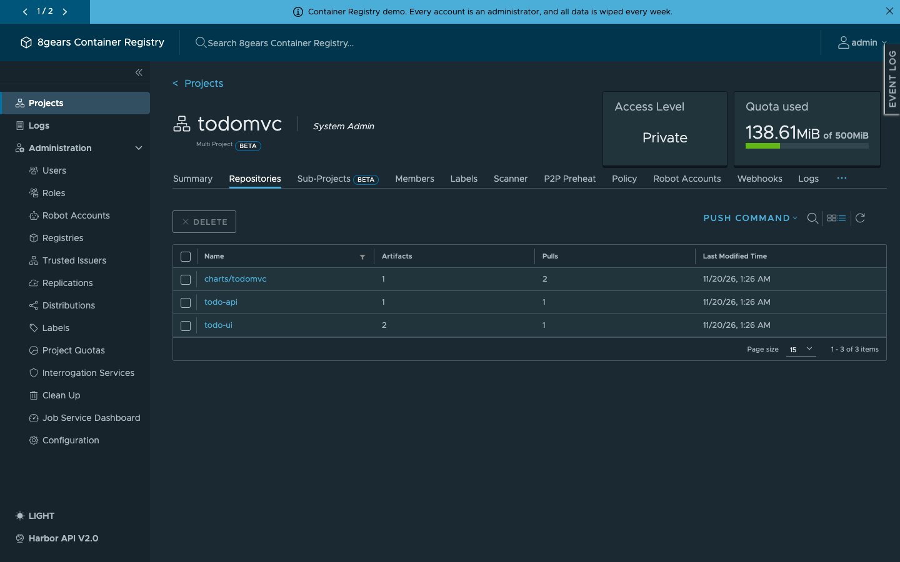

# 4. Images

[← 3. npm](04-npm.md) · [5. Helm chart →](06-helm-chart.md)

Both apps are built into container images. Their base images come through the
`todomvc` multi-project, and the app images are pushed into it.

## Base images through the multi-project

Both Dockerfiles take the base image registry from a build argument:

```dockerfile
ARG BASE_REGISTRY=docker.io/library
FROM ${BASE_REGISTRY}/maven:3.9-eclipse-temurin-21 AS build
...
FROM ${BASE_REGISTRY}/eclipse-temurin:21-jre-alpine
```

CI sets `BASE_REGISTRY=demo.container-registry.com/todomvc/library`. A pull of
`todomvc/library/maven` misses in `todomvc` itself and is served by its
`dockerhub` sub-project from Docker Hub. The default stays `docker.io/library`
so that a plain `docker build` works for someone without a token: `todomvc` is
private.

A pull through the multi-project with a token that has a grant on `todomvc`
only (here the cluster's ServiceAccount token, see
[7. Flux deploy](08-flux-deploy.md)):

```console
$ kubectl -n todomvc create token todomvc --audience demo.container-registry.com \
    | crane auth login demo.container-registry.com -u jwt --password-stdin
$ crane digest demo.container-registry.com/todomvc/library/nginx:alpine
sha256:fb4658584bd9a916ffb6f6e365f97c25cfdb2923801f551ea08356e695f14ff7
```

## Dependencies inside the build

Inside `docker build` the apps resolve their dependencies with the committed
`.mvn/settings.xml` and `.npmrc`, so through the `maven-central` and `npmjs`
proxies. `docker build` gets no credential, which is why those projects are
public.

## Build and push

The `images` job of [the pipeline](07-pipeline.md) builds with
`docker/build-push-action` and pushes afterwards with a fresh token:

```yaml
- uses: docker/build-push-action@10e90e3645eae34f1e60eeb005ba3a3d33f178e8 # v6.19.2
  with:
    context: apps/${{ matrix.app }}
    load: true
    build-args: |
      BASE_REGISTRY=${{ env.OCI_PROJECT }}/library
    tags: |
      ${{ env.OCI_PROJECT }}/${{ matrix.app }}:${{ github.sha }}
      ${{ env.OCI_PROJECT }}/${{ matrix.app }}:${{ steps.version.outputs.version }}
- run: |
    printf '%s' "$HARBOR_PASSWORD" | docker login "$REGISTRY" -u jwt --password-stdin
    docker push --all-tags "$IMAGE"
```

From the CI publish run:

```console
0.1.13: digest: sha256:d5f3dbc92d66cbaa4a814bd35af62a77fe482f3de9c543957851b899ba88bab3 size: 1812
bfa6cd622e89eddf64c7845059ce0d64f7ac1f6f: digest: sha256:d5f3dbc92d66cbaa4a814bd35af62a77fe482f3de9c543957851b899ba88bab3 size: 1812
```

The `todo-api` build took 5 min 56 s, of which Maven inside the image took
4:43; `todo-ui` took 51 s.



## A note on misses

A pull that misses the multi-project's own content asks each proxy sub-project's
upstream. That includes the existence check `docker push` makes before
uploading a new tag: pushing `todomvc/todo-ui:<sha>` made core ask Docker Hub
for `todo-ui:<sha>`, visible in the core log as
`failed to check remote manifest todo-ui:<sha> for sub-project dockerhub: http status code: 401`.
Image names pushed to a multi-project are therefore sent to its proxy
upstreams.

## Next

[5. Helm chart](06-helm-chart.md)
