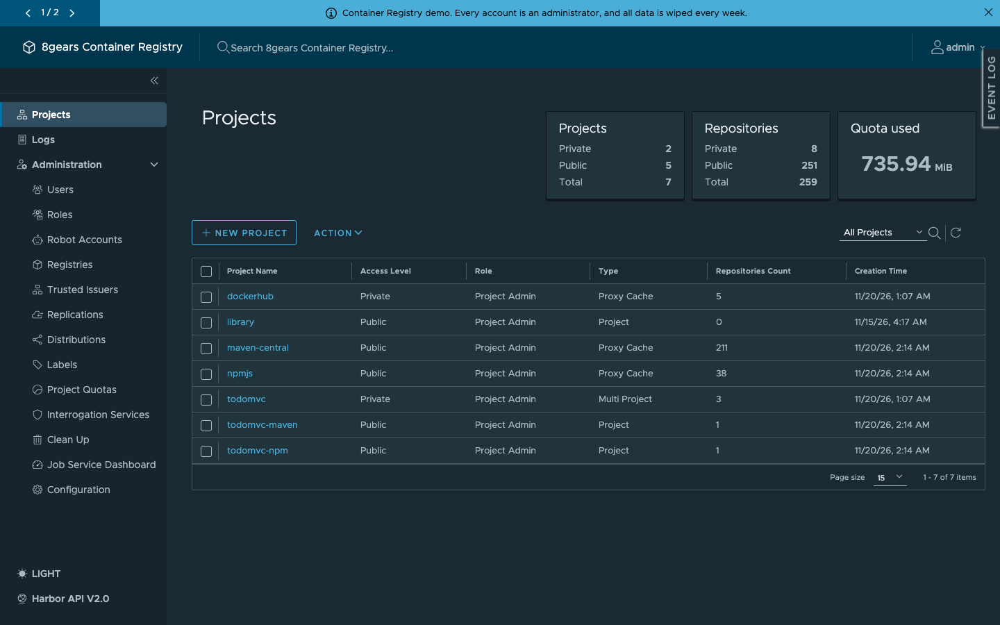
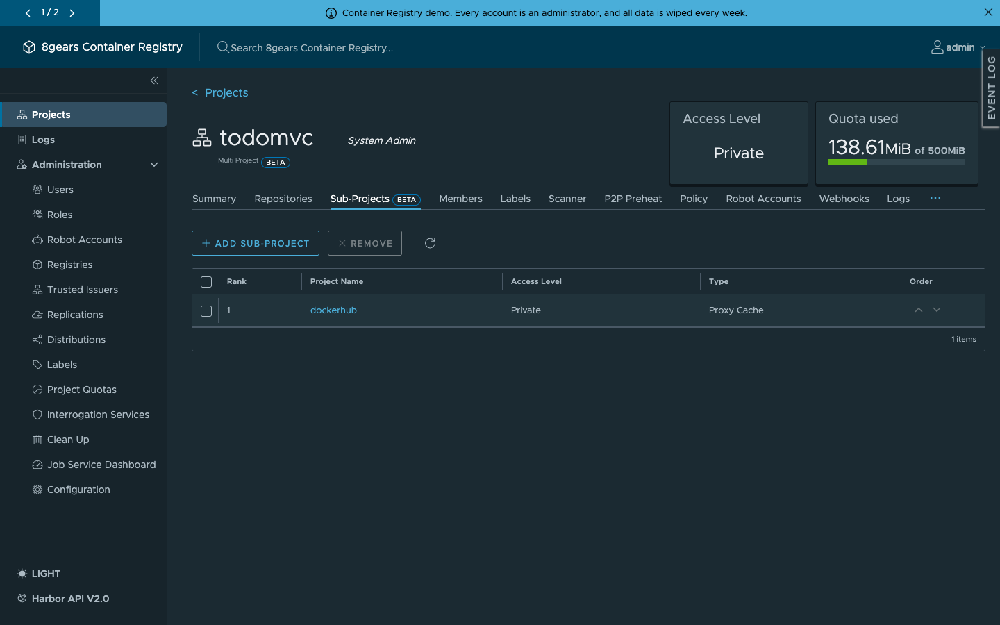
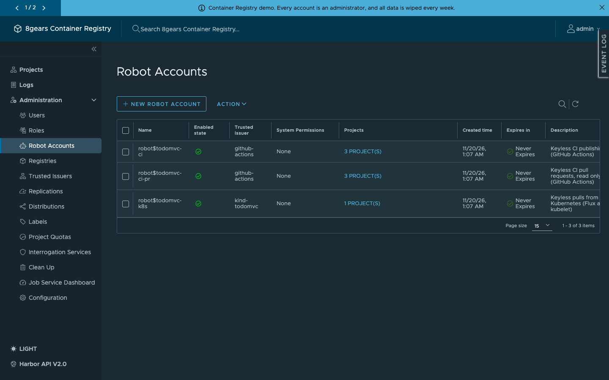

# 1. Setup

[← Concepts](01-concepts.md) · [2. Maven →](03-maven.md)

[`setup.py`](../setup.py) is the only provisioning
step. It is idempotent and checks every existing object against what it would
create, so it is safe to rerun.

## Requirements

8gcr / Harbor Next 2.16 with *Multi-Format Artifacts* and *Federated Robot
Accounts* enabled:

```console
$ curl -s -u "admin:$HARBOR_PASS" https://demo.container-registry.com/api/v2.0/features \
    | jq -r '.features[] | select(.section=="commercial" and .enabled) | .key'
enable_commercial_branding
enable_commercial_federated_robot_accounts
enable_commercial_multi_format_artifacts
enable_commercial_pgx_monitoring
```

## Run the setup script

```console
$ export HARBOR_URL=https://demo.container-registry.com HARBOR_PASS=...
$ export API=$HARBOR_URL/api/v2.0      # used by the curl examples below
$ ./setup.py

==> Target: https://demo.container-registry.com (audience: demo.container-registry.com)
  ok authenticated

==> Registry endpoints (upstreams to cache from)
  ok endpoint npmjs id=1 npm -> https://registry.npmjs.org
  ok endpoint maven-central id=2 maven -> https://repo1.maven.org/maven2
  ok endpoint dockerhub id=3 docker-hub -> https://hub.docker.com

==> Proxy-cache projects (read-only)
  ok project npmjs (proxy cache of npmjs, public=true)
  ok project maven-central (proxy cache of maven-central, public=true)
  ok project dockerhub (proxy cache of dockerhub, public=false)

==> Hosted projects
  ok project todomvc-npm (hosted, public)
  ok project todomvc-maven (hosted, public)

==> Multi-project
  ok todomvc -> sub-project dockerhub rank 1
  ok multi-project todomvc (private; own pushes first, then sub-projects by rank)

==> Trusted issuer: GitHub Actions OIDC
  ok trusted issuer github-actions id=1 https://token.actions.githubusercontent.com, audience demo.container-registry.com, online (follows key rotation)

==> Secretless robots for CI
  ok robot robot$todomvc-ci id=1 <- repository = container-registry/harbor-multi-artifact-support-examples, ref = refs/heads/main
  ok robot robot$todomvc-ci-pr id=2 <- repository = container-registry/harbor-multi-artifact-support-examples, event_name = pull_request

==> Done
    images, chart -> demo.container-registry.com/todomvc/{todo-api,todo-ui,charts/todomvc}
    base images   -> demo.container-registry.com/todomvc/library/<image> (via dockerhub)
    npm           -> resolve https://demo.container-registry.com/npm/npmjs/, publish @todomvc/* to https://demo.container-registry.com/npm/todomvc-npm/
    Maven         -> mirror https://demo.container-registry.com/maven/maven-central, deploy to https://demo.container-registry.com/maven/todomvc-maven
    CI auth       -> GitHub OIDC token, audience demo.container-registry.com, repository container-registry/harbor-multi-artifact-support-examples
```

This run took 13 s. For your own fork, set `GITHUB_REPO=<owner>/<repo>` first.
A rerun reconciles robot permissions and claim rules. On builds newer than
v2.16.0, set `PKG_ROOT=/pkg` so the printed package URLs match.



## What the script does, as API calls

The script is the reference; these are the calls it makes, for reading.

### Endpoints and proxy-cache projects

`registry_id` can only be set when the project is created.

```bash
curl -su "admin:$HARBOR_PASS" -H 'Content-Type: application/json' -X POST "$API/registries" \
  -d '{"name":"npmjs","type":"npm","url":"https://registry.npmjs.org"}'
curl -su "admin:$HARBOR_PASS" -H 'Content-Type: application/json' -X POST "$API/projects" \
  -d '{"project_name":"npmjs","registry_id":1,"metadata":{"public":"true"}}'
```

The endpoint type list in the portal (**Administration → Registries → New
Endpoint**) does not offer npm or Maven on the demo, because it comes from
`GET /replication/adapters`, which is filtered for replication. `POST
/registries` accepts `npm`, `maven` and the other package types regardless.

### Hosted projects

A plain project. npm and Maven publishing into it works without any
package-type setting.

```bash
curl -su "admin:$HARBOR_PASS" -H 'Content-Type: application/json' -X POST "$API/projects" \
  -d '{"project_name":"todomvc-npm","metadata":{"public":"true"}}'
```

### The multi-project

`multi_project` is create-only and cannot be combined with `registry_id`.
Sub-projects are added by name or id, with a rank:

```bash
curl -su "admin:$HARBOR_PASS" -H 'Content-Type: application/json' -X POST "$API/projects" \
  -d '{"project_name":"todomvc","metadata":{"public":"false","multi_project":"true"}}'
curl -su "admin:$HARBOR_PASS" -H 'Content-Type: application/json' -X POST "$API/projects/todomvc/subprojects" \
  -d '{"sub_project_name":"dockerhub","rank":1}'
```

```console
$ curl -s -u "admin:$HARBOR_PASS" "$API/projects/todomvc/subprojects" | jq -c '.[]'
{"sub_project_name":"dockerhub","rank":1,"is_proxy":true,...}
```



### Trusted issuer

`audience` is required and immutable; issuer plus audience identifies the
trusted issuer. Online validation fetches GitHub's discovery document and
follows its key rotation.

```bash
curl -su "admin:$HARBOR_PASS" -H 'Content-Type: application/json' -X POST "$API/trusted-issuers" \
  -d '{"name":"github-actions","audience":"demo.container-registry.com","offline_validation":false,
       "openid_config_url":"https://token.actions.githubusercontent.com/.well-known/openid-configuration"}'
```

The Kubernetes trusted issuer is created by `setup.py kind`, see
[7. Flux deploy](08-flux-deploy.md#trust-the-cluster-in-harbor).

### Secretless robots and claim rules

A robot created with `trusted_issuer_id` has no secret. A token becomes the
robot whose claim rules it satisfies; when several match, the robot with the
most matching rules wins. Here the two CI robots never overlap:

| Robot | Claim rules | Token from a pull request | Token from `main` | Token from any other branch |
|---|---|---|---|---|
| `todomvc-ci` (push) | `repository`, `ref = refs/heads/main` | no match (`ref` is `refs/pull/<n>/merge`) | match | no match |
| `todomvc-ci-pr` (pull) | `repository`, `event_name = pull_request` | match | no match | no match |

```bash
curl -su "admin:$HARBOR_PASS" -H 'Content-Type: application/json' -X POST "$API/trusted-issuers/1/claims" \
  -d '{"rules":[{"robot_id":2,"claim_path":"repository","value":"container-registry/harbor-multi-artifact-support-examples"},
                {"robot_id":2,"claim_path":"event_name","value":"pull_request"}]}'
```

Two robots on one trusted issuer cannot have identical claim sets, and `aud`
and `iss` are rejected as claim rules because they belong to the issuer.



## Check it

```console
$ curl -s -o /dev/null -w '%{http_code} %{content_type}\n' https://demo.container-registry.com/npm/npmjs/vue
200 application/json
$ curl -s -o /dev/null -w '%{http_code} %{content_type}\n' \
    https://demo.container-registry.com/maven/maven-central/junit/junit/4.13.2/junit-4.13.2.pom
200 text/xml
$ crane manifest demo.container-registry.com/todomvc/library/nginx:alpine
Error: fetching manifest ...: UNAUTHORIZED: unauthorized to access repository: todomvc/library/nginx, action: pull
```

The last one is correct: `todomvc` is private. A JSON or XML answer is the
success signal for the package URLs; an HTML answer means the path did not
reach the package handler.

## Next

[2. Maven](03-maven.md)
