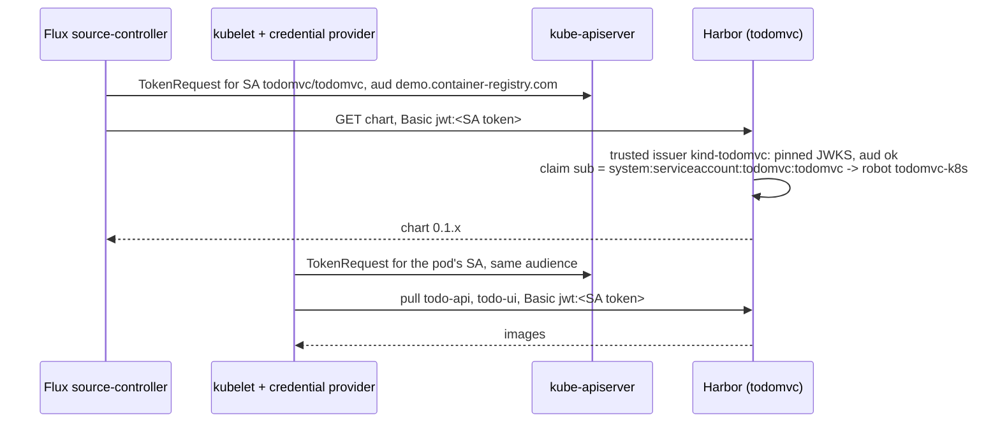
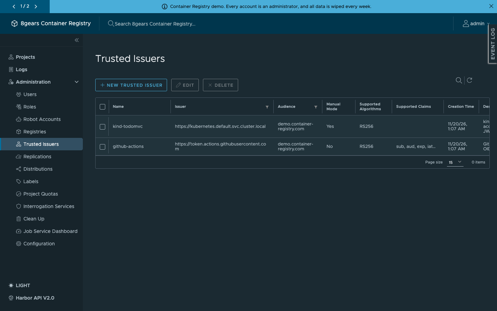
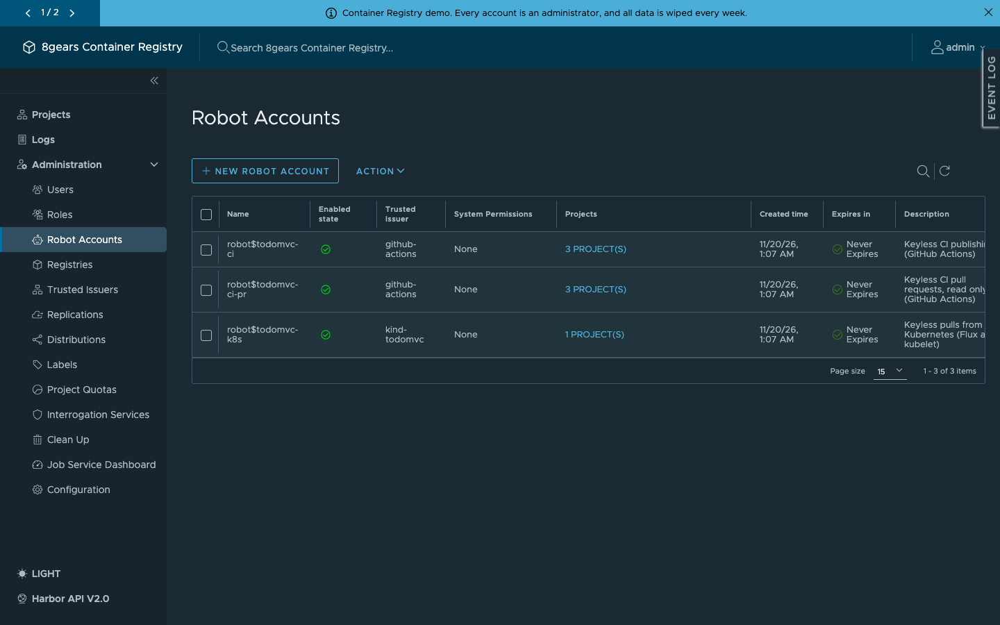
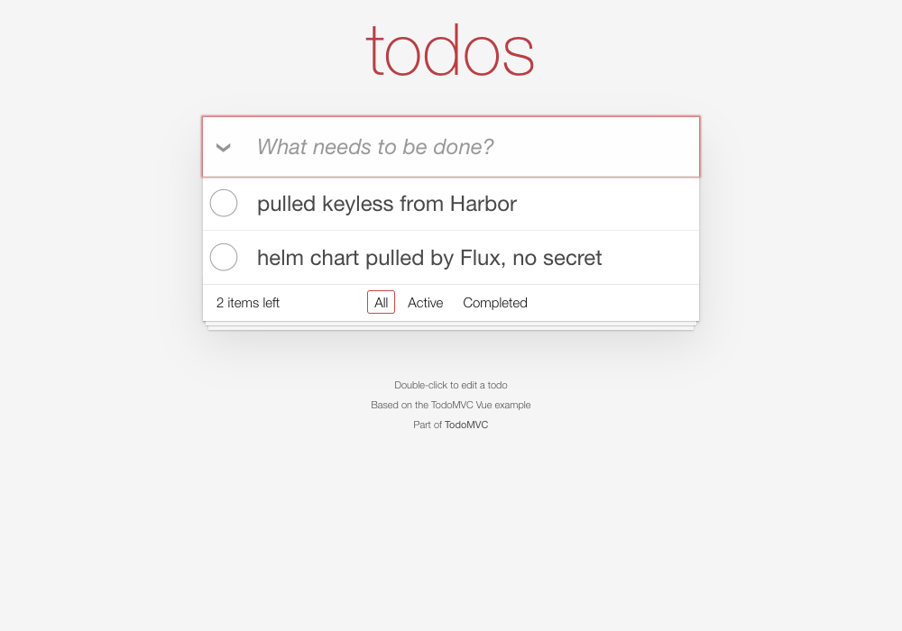

# 7. Flux deploy

[← 6. Pipeline](07-pipeline.md) · [README](../README.md)

The chart and images from [4](05-images.md) and [5](06-helm-chart.md) sit in the private `todomvc`
multi-project. A kind cluster now deploys them with Flux, and nothing in the
cluster holds a registry secret: Flux's source-controller and the kubelet both
present a token of the ServiceAccount `todomvc/todomvc`, and Harbor maps that
token to the pull-only robot `todomvc-k8s`.



Versions used: kind v0.33.0, Kubernetes v1.37.0, Flux v2.10.0, Docker Desktop on
arm64 macOS.

## Which mechanism, and why

**Flux: native.** Flux 2.10 (source-controller v1.10) authenticates
`provider: generic` OCI sources with a ServiceAccount token when the account
carries `credential.auth.fluxcd.io/provider: kubernetes` and
`credential.auth.fluxcd.io/type: jwt`. With
`credential.auth.fluxcd.io/username` set, the token goes in the Basic password,
which is what Harbor reads. Earlier Flux releases had no OIDC for generic
registries and needed a token refresher writing a docker-config Secret; that is
no longer necessary.

**kubelet: the ServiceAccount token credential provider (KEP-4412).** A kubelet
credential provider can ask the kubelet for a token of the pulling pod's own
ServiceAccount (`tokenAttributes` in the `CredentialProviderConfig`). The
provider here, [`deploy/kind/credential-provider`](../deploy/kind/credential-provider/main.go),
is 82 lines of Go: it returns `jwt` plus that token for the registry host. The
alternative, a refreshed `imagePullSecret`, would put a long-lived object back
in the cluster and need a controller to rotate it. With the provider, each pod
pulls as its own ServiceAccount, so a pod running as any other account is
refused (shown below).

## Build the provider and create the cluster

```console
$ docker run --rm -v "$PWD/deploy/kind/credential-provider:/src" -w /src -e CGO_ENABLED=0 \
    golang:1.26-alpine go build -trimpath -o bin/harbor-sa-credential-provider .
$ kind create cluster --config deploy/kind/kind-config.yaml
...
You can now use your cluster with:

kubectl cluster-info --context kind-todomvc
$ kubectl apply -f deploy/kind/node-audience-rbac.yaml
clusterrole.rbac.authorization.k8s.io/harbor-registry-audience created
clusterrolebinding.rbac.authorization.k8s.io/harbor-registry-audience created
```

Run these from `end-to-end/todomvc-keyless-flux`; the kind config mounts the binary and
[`credential-provider-config.yaml`](../deploy/kind/credential-provider-config.yaml)
into the node by relative path. Cluster creation took 13 s.

Two settings are not optional, and both were found by failing:

- `cacheType: Token`. With `ServiceAccount` the kubelet rejects the response:
  `credential provider plugin returned the service account token as the password which is not allowed when service account cache type is not set to 'Token'`.
- [`node-audience-rbac.yaml`](../deploy/kind/node-audience-rbac.yaml) grants
  the nodes `request-serviceaccounts-token-audience` for
  `demo.container-registry.com`. Without it the kubelet log shows
  `system:node:todomvc-control-plane is not authorized to request tokens for audience "demo.container-registry.com"`.

## Trust the cluster in Harbor

A kind API server is not reachable from Harbor, and every kind cluster uses the
same issuer URL, `https://kubernetes.default.svc.cluster.local`. So the trusted
issuer is created in offline mode with the cluster's signing keys pinned. The
pinned key, together with the audience, is what makes it *this* cluster.

```console
$ ./setup.py kind

==> Target: https://demo.container-registry.com (audience: demo.container-registry.com)
  ok authenticated

==> Trusted issuer: kind cluster (kind-todomvc)
  ok trusted issuer kind-todomvc id=2 https://kubernetes.default.svc.cluster.local, audience demo.container-registry.com, offline (pinned keys)

==> Secretless robot for the cluster
  ok robot robot$todomvc-k8s id=3 <- sub = system:serviceaccount:todomvc:todomvc

==> Done
    kid(s) pinned: 19Es2QMAFaGYGoZEBng3WH25CW1n72f-clk7D8bR2Tw
```

It reads `/.well-known/openid-configuration` and `/openid/v1/jwks` through
kubectl. A recreated cluster has new keys; rerunning the command replaces the
pinned set. Run it against your own instance: on a shared one it would
replace the keys that someone else's `kind-todomvc` issuer trusts.





Quick check that a ServiceAccount token is accepted, before involving Flux:

```console
$ kubectl apply -f deploy/flux/namespace.yaml
$ kubectl -n todomvc create token todomvc --audience $HOST \
    | crane auth login $HOST -u jwt --password-stdin
$ crane digest $HOST/todomvc/library/nginx:alpine
sha256:fb4658584bd9a916ffb6f6e365f97c25cfdb2923801f551ea08356e695f14ff7
```

That pull went through the multi-project to its `dockerhub` sub-project, with a
robot that only has a grant on `todomvc`.

## Install Flux and the app

```console
$ kubectl apply -f https://github.com/fluxcd/flux2/releases/download/v2.10.0/install.yaml
$ kubectl -n flux-system wait --for=condition=Available deploy --all --timeout=300s
$ kubectl apply -f deploy/flux/
$ kubectl -n todomvc get ocirepository,helmrelease
NAME                                                   URL                                                        READY   STATUS
ocirepository.source.toolkit.fluxcd.io/todomvc-chart   oci://demo.container-registry.com/todomvc/charts/todomvc   True    stored artifact for digest '0.1.12@sha256:81560196a69fbb0b6ac5e09382d2f239086fdbbfa5014aae1179f2d59cec6be6'

NAME                                         READY   STATUS
helmrelease.helm.toolkit.fluxcd.io/todomvc   True    Helm install succeeded for release todomvc/todomvc.v1 with chart todomvc@0.1.12+81560196a69f
```

The OCIRepository was ready 4 s after apply, the HelmRelease 26 s later.
The manifests are in [`deploy/flux/`](../deploy/flux):
[`todomvc.yaml`](../deploy/flux/todomvc.yaml) holds the OCIRepository
(`semver: ">=0.1.0-0"`, which works because the chart is the multi-project's
own content, see [Concepts](01-concepts.md#oci-one-multi-project)) and the
HelmRelease, and [`deploy/flux/namespace.yaml`](../deploy/flux/namespace.yaml) holds the
annotated ServiceAccount and a Role that lets source-controller mint tokens for
that one account. Flux 2.10 removed `serviceaccounts/token` from its default
RBAC, so without the Role the OCIRepository cannot get a token.

The kubelet pulled both images with the provider; the pods have no
`imagePullSecrets`:

```console
$ kubectl -n todomvc get events | grep Pulled
Successfully pulled image "demo.container-registry.com/todomvc/todo-ui:0c68a328fe87be9e0dc88498374aa861be060be3" in 3.508s (3.508s including waiting). Image size: 26382386 bytes.
Successfully pulled image "demo.container-registry.com/todomvc/todo-api:0c68a328fe87be9e0dc88498374aa861be060be3" in 5.505s (9.013s including waiting). Image size: 122762284 bytes.
$ kubectl -n todomvc get pod -o jsonpath='{range .items[*]}{.metadata.name} sa={.spec.serviceAccountName} pullSecrets={.spec.imagePullSecrets}{"\n"}{end}'
todo-api-85f6dcc54f-5h67d sa=todomvc pullSecrets=
todo-ui-7444487b49-wc9jt sa=todomvc pullSecrets=
```

```console
$ kubectl -n todomvc port-forward svc/todo-ui 8081:80 &
$ curl -s -X POST -H 'Content-Type: application/json' -d '{"title":"pulled keyless from Harbor"}' localhost:8081/api/todos
{"id":1,"title":"pulled keyless from Harbor","completed":false}
```



When the next publish run pushed chart 0.1.13, Flux picked it up on its own
within the OCIRepository's one-minute interval, and the kubelet pulled the new
images the same way:

```console
$ kubectl -n todomvc get helmrelease todomvc -o jsonpath='{.status.conditions[?(@.type=="Ready")].message}'
Helm upgrade succeeded for release todomvc/todomvc.v2 with chart todomvc@0.1.13+e05977683c43
$ kubectl -n todomvc get pods -o custom-columns='N:.metadata.name,READY:.status.containerStatuses[0].ready,IMG:.spec.containers[0].image'
N                           READY   IMG
todo-api-59cbb49797-7dtk5   true    demo.container-registry.com/todomvc/todo-api:bfa6cd622e89eddf64c7845059ce0d64f7ac1f6f
todo-ui-58c7864f97-tf7b5    true    demo.container-registry.com/todomvc/todo-ui:bfa6cd622e89eddf64c7845059ce0d64f7ac1f6f
```

## Proof that the token is what grants access

Same node, same image, `imagePullPolicy: Always`, two ServiceAccounts:

```console
$ kubectl -n todomvc create sa other
$ kubectl -n todomvc run probe-other --image=$HOST/todomvc/todo-api:0c68a32... \
    --overrides='{"spec":{"serviceAccountName":"other"}}' --image-pull-policy=Always --restart=Never
$ kubectl -n todomvc run probe-todomvc --image=$HOST/todomvc/todo-api:0c68a32... \
    --overrides='{"spec":{"serviceAccountName":"todomvc"}}' --image-pull-policy=Always --restart=Never --command -- true
$ kubectl -n todomvc get pod probe-other probe-todomvc -o custom-columns='N:.metadata.name,P:.status.phase,W:.status.containerStatuses[0].state.waiting.reason,T:.status.containerStatuses[0].state.terminated.reason'
N               P           W              T
probe-other     Pending     ErrImagePull   <none>
probe-todomvc   Succeeded   <none>         Completed
$ kubectl -n todomvc get pod probe-other -o jsonpath='{.status.containerStatuses[0].state.waiting.message}'
failed to pull and unpack image "demo.container-registry.com/todomvc/todo-api:0c68a32...": failed to resolve reference ...: unexpected status from HEAD request to https://demo.container-registry.com/v2/todomvc/todo-api/manifests/0c68a32...: 401 Unauthorized
```

This ran with the node grant of [`node-audience-rbac.yaml`](../deploy/kind/node-audience-rbac.yaml)
covering every ServiceAccount: `other` got a valid token from the same cluster,
but no claim rule maps `system:serviceaccount:todomvc:other` to a robot, so
Harbor treated it as anonymous, and `todomvc` is private.

The committed grant is narrower: `resourceNames: ["todomvc"]` lets the kubelet
mint the registry-audience token for that one account only. Rerun with it,
`other` now fails one step earlier, in the kubelet, while `todomvc` still pulls:

```console
$ kubectl -n todomvc get pod p-todomvc p-other -o custom-columns='N:.metadata.name,P:.status.phase,W:.status.containerStatuses[0].state.waiting.reason'
N           P           W
p-todomvc   Succeeded   <none>
p-other     Pending     ImagePullBackOff
$ journalctl -u kubelet | grep -o 'is not authorized to request tokens[^"]*"[^"]*"'
is not authorized to request tokens for audience \"demo.container-registry.com\"
```

An OCIRepository without `serviceAccountName` fails the same way:

```console
failed to determine the artifact tag for 'oci://demo.container-registry.com/todomvc/charts/todomvc': GET https://demo.container-registry.com/v2/todomvc/charts/todomvc/tags/list?n=1000: UNAUTHORIZED: unauthorized to access repository: todomvc/charts/todomvc, action: pull
```

## Clean up

```bash
kind delete cluster --name todomvc
```

The trusted issuer `kind-todomvc` stays in Harbor with keys nobody holds any
more; delete it under **Administration → Trusted Issuers**.
